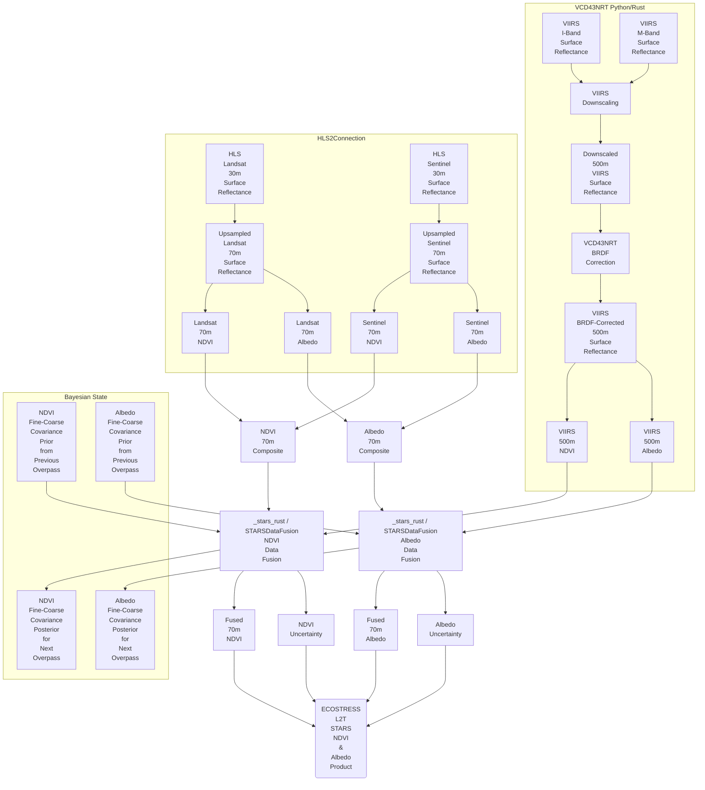

# ECOSTRESS Collection 3 Level 2 STARS Vegetation Index & Albedo

This is the main repository for the ECOsystem Spaceborne Thermal Radiometer Experiment on Space Station (ECOSTRESS) collection 3 level 2 STARS NDVI and albedo data product. This product utilizes the [Spatial Timeseries for Automated high-Resolution multi-Sensor (STARS)](https://github.com/STARS-Data-Fusion) data fusion system to produce normalized difference vegetation index (NDVI) and albedo estimates corresponding to ECOSTRESS surface temperature measurements, to support the [evapotranspiration product](https://github.com/ECOSTRESS-Collection-3/ECOv003-L3T-L4T-JET).

The ECOSTRESS collection 3 level 2 vegetation index and albedo data product is the pre-cursor to the [Surface Biology and Geology (SBG) collection 1 level 2 vegetation index and albedo data product algorithm](https://github.com/sbg-tir/SBG-TIR-L2-STARS).

[Gregory H. Halverson](https://github.com/gregory-halverson-jpl) (they/them)<br>
[gregory.h.halverson@jpl.nasa.gov](mailto:gregory.h.halverson@jpl.nasa.gov)<br>
NASA Jet Propulsion Laboratory 329G

[Margaret C. Johnson](https://github.com/majohnso) (she/her)<br>
[maggie.johnson@jpl.nasa.gov](mailto:maggie.johnson@jpl.nasa.gov)<br>
NASA Jet Propulsion Laboratory 398L

[Evan Davis](https://github.com/evandjpl) (he/him)<br>
[evan.w.davis@jpl.nasa.gov](mailto:evan.w.davis@jpl.nasa.gov)<br>
NASA Jet Propulsion Laboratory 397K

[Kerry Cawse-Nicholson](https://github.com/kcawse) (she/her)<br>
[kerry-anne.cawse-nicholson@jpl.nasa.gov](mailto:kerry-anne.cawse-nicholson@jpl.nasa.gov)<br>
NASA Jet Propulsion Laboratory 329G

[Claire Villanueva-Weeks](https://github.com/clairesvw) (she/her)<br>
[claire.s.villanueva-weeks@jpl.nasa.gov](mailto:claire.s.villanueva-weeks@jpl.nasa.gov)<br>
NASA Jet Propulsion Laboratory 329G

The code for the ECOSTRESS level 2 STARS PGE has been developed using open-science practices based on the [ECOSTRESS collection 2 gridded and tiled product generation software](https://github.com/ECOSTRESS-Collection-2/ECOSTRESS-Collection-2).

This software produces estimates of:
- Normalized Difference Vegetation Index (NDVI)
- Albedo

NDVI and albedo are estimated at 70 m ECOSTRESS standard resolution for each daytime ECOSTRESS overpass by fusing temporally sparse but fine spatial resolution images from the Harmonized Landsat Sentinel (HLS) 2.0 product with daily, moderate spatial resolution images from VIIRS. The VCD43NRT package uses Suomi NPP first, with JPSS-1 and JPSS-2 available as mission fallbacks, to provide those VIIRS inputs. The data fusion is performed using a variant of the Spatial Timeseries for Automated high-Resolution multi-Sensor data fusion (STARS) algorithm developed by Dr. Margaret Johnson and Gregory Halverson at the Jet Propulsion Laboratory. STARS is a Bayesian timeseries methodology that provides streaming data fusion and uncertainty quantification through efficient Kalman filtering, implemented in a compiled Rust/PyO3 extension (`_stars_rust`, default) with an optional legacy Julia backend (`STARSDataFusion.jl`).

Operationally, each L2T STARS tile run loads the means and covariances of the STARS model saved from the most recent tile run, then iteratively advances the means and covariances forward each day updating with fine imagery from HLS and/or moderate resolution imagery from VIIRS up to the day of the target ECOSTRESS overpass. VCD43NRT applies the near-real-time BRDF workflow to daily VIIRS observations to produce the coarse NDVI and albedo inputs.

## 1. Introduction to Data Products

The data format for the ECOSTRESS products is described in the [ECOSTRESS Collection 3 landing page](https://github.com/ECOSTRESS-Collection-3).

## 2. L2T STARS NDVI and Albedo Product



*Figure 1. Flowchart of the ECOSTRESS Collection 3 L2T STARS processing workflow.*

NDVI and albedo are estimated at 70 m ECOSTRESS standard resolution with uncertainty for each UTC day in which there is an ECOSTRESS overpass by fusing temporally sparse but fine spatial resolution images from the Harmonized Landsat Sentinel (HLS) 2.0 product with daily, moderate spatial resolution VIIRS observations. Suomi NPP is preferred; JPSS-1 and JPSS-2 can fill dates without a preferred-mission observation.

Landsat and Sentinel surface reflectances are collected using the [harmonized-landsat-sentinel](https://github.com/nasa-jpl/harmonized-landsat-sentinel) (`HLS2Connection`) package.

VIIRS surface reflectance is processed by the [VCD43NRT](https://github.com/JPL-Evapotranspiration-Algorithms/VCD43NRT) package. It selects observations per date using the configured mission priority (SNPP, JPSS-1, JPSS-2 by default), then applies the near-real-time BRDF workflow to produce VIIRS NDVI and albedo.

The data fusion is performed with a variant of the Spatial Timeseries for Automated high-Resolution multi-Sensor data fusion (STARS) algorithm developed by Dr. Margaret Johnson and Gregory H. Halverson at the Jet Propulsion Laboratory. By default, data fusion executes via the compiled Rust extension (`_stars_rust`), with the legacy Julia implementation ([STARSDataFusion.jl](https://github.com/STARS-Data-Fusion/STARSDataFusion.jl)) available via `--backend julia`. Operationally, each L2T STARS tile run loads the means and covariances of the STARS model saved from the most recent tile run, then iteratively advances the means and covariances forward each day updating with fine imagery from HLS and/or moderate resolution imagery from VIIRS up to the day of the target ECOSTRESS overpass.

The layers of the L2T STARS product are listed in Table 2. Data and uncertainty layers are represented by 32-bit floating point arrays (`float32`), and flag layers by 32-bit integer arrays (`int32`). The NDVI estimates and 1σ uncertainties (-UQ) are unitless from -1 to 1. The albedo estimates and 1σ uncertainties (-UQ) are proportions from 0 to 1.

| **Name** | **Description** | **Type** | **Units** | **Fill Value** | **No Data Value** | **Valid Min** | **Valid Max** | **Scale Factor** | **Size** |
| --- | --- | --- | --- | --- | --- | --- | --- | --- | --- |
| NDVI | Normalized Difference Vegetation Index | float32 | Index | NaN | N/A | -1 | 1 | N/A | 9.83 MB |
| NDVI-UQ | Normalized Difference Vegetation Index Uncertainty | float32 | Index | NaN | N/A | 0 | 1 | N/A | 9.83 MB |
| NDVI-bias | Coarse-to-Fine NDVI Sensor Bias | float32 | Index | NaN | N/A | -1 | 1 | N/A | 0.20 MB |
| NDVI-bias-UQ | Coarse-to-Fine NDVI Sensor Bias Uncertainty | float32 | Index | NaN | N/A | 0 | 1 | N/A | 0.20 MB |
| NDVI-flag | 7-Day HLS NDVI Availability Flag | int32 | Mask | -9999 | N/A | 0 | 1 | N/A | 9.83 MB |
| albedo | Albedo | float32 | Ratio | NaN | N/A | 0 | 1 | N/A | 9.83 MB |
| albedo-UQ | Albedo Uncertainty | float32 | Ratio | NaN | N/A | 0 | 1 | N/A | 9.83 MB |
| albedo-bias | Coarse-to-Fine Albedo Sensor Bias | float32 | Ratio | NaN | N/A | -1 | 1 | N/A | 0.05 MB |
| albedo-bias-UQ | Coarse-to-Fine Albedo Sensor Bias Uncertainty | float32 | Ratio | NaN | N/A | 0 | 1 | N/A | 0.05 MB |
| albedo-flag | 7-Day HLS Albedo Availability Flag | int32 | Mask | -9999 | N/A | 0 | 1 | N/A | 9.83 MB |

*Table 2. Listing of L2T STARS data layers.*

## 3. Prerequisites & Authentication

### System Requirements
- Python `>=3.11` (`3.12` recommended for production containers)
- A Rust toolchain (`rustc` / `cargo` + `maturin`) when building from source (not required when installing pre-built wheels)
- GDAL with NetCDF4 and HDF5 plugins (`libgdal-netcdf`, `libgdal-hdf5`) for reading GEOS-5 FP `.nc4` meteorological/aerosol files
- Optional: Julia `1.11.6` if running the legacy `--backend julia` data fusion engine

### Authentication
This package requires an [EarthData](https://urs.earthdata.nasa.gov/) account and reads EarthData credentials from `~/.netrc` (or `EARTHDATA_USERNAME` / `EARTHDATA_PASSWORD` environment variables) in the following format:

```
machine urs.earthdata.nasa.gov
login <USERNAME>
password <PASSWORD>
```

## 4. Environment & Installation

### Conda / Mamba Environment
```bash
mamba create -y -n ECOv003-L2T-STARS -c conda-forge python=3.12 libgdal-netcdf libgdal-hdf5 rasterio
mamba activate ECOv003-L2T-STARS
```

### Installing the Package
Install from PyPI (includes pre-compiled `_stars_rust` extension wheels):

```bash
pip install ECOv003-L2T-STARS
```

Or build and install from a local source checkout:

```bash
make install
```

Run the built-in smoke test to verify Python imports and the compiled Rust extension:

```bash
ECOv003-L2T-STARS test
```

### Optional Legacy Julia Backend Setup
The default `--backend rust` engine requires no Julia installation. To install the optional legacy Julia `1.11.6` runtime and manifest-pinned packages (`STARSDataFusion.jl`), run:

```bash
ECOv003-L2T-STARS install-julia
```

Or from Python:

```python
import ECOv003_L2T_STARS

ECOv003_L2T_STARS.install_julia()
```

To verify an existing Julia installation without modifying it, run `ECOv003-L2T-STARS-install-julia --verify-only`.

## 5. Usage

Import this package with underscores:

```python
import ECOv003_L2T_STARS
```

### VCD43NRT Example
To generate a VIIRS NRT granule for a date and MODLAND tile, edit the settings in [example_VCD43NRT.py](example_VCD43NRT.py) and run:

```bash
python example_VCD43NRT.py
```

The example requires Earthdata credentials for VIIRS downloads and access to GEOS-5 FP data. Mission selection is performed per observation date. Set `VCD43NRT_VJ209GA_CONCEPT_ID` when the deployment needs a JPSS-2 CMR concept-ID override.

### Command Line Usage

#### `ECOv003-L2T-STARS` PGE Entry-Point

```bash
ECOv003-L2T-STARS <runconfig> [--date YYYY-MM-DD] [--spinup-days DAYS] [--target-resolution METERS] [--ndvi-resolution METERS] [--albedo-resolution METERS] [--viirs-mission-priority SNPP,JPSS1,JPSS2] [--calibrate-fine] [--sources-only] [--no-remove-input-staging] [--no-remove-prior] [--no-remove-posterior] [--backend {rust,julia}] [--initialize-julia] [--threads COUNT] [--num-workers COUNT] [--overwrite] [--version]
```

#### `ECOv003_DL` Downloader PGE Entry-Point

```bash
ECOv003_DL <runconfig_filename> [--tiles TILE_ID [TILE_ID ...]] [--version]
```

## 6. Known Issues & Operational Troubleshooting

The table below tracks known runtime and operational issues affecting `ECOv003-L2T-STARS` and its upstream dependencies, identified from forward-processing I&T DAG log triage (`EcostressDAG_Col3.46000.0802.20261116T001911117`):

| Severity | Tracking Issue | Log Signature | Root Cause | Resolution / Operational Guidance |
| :--- | :--- | :--- | :--- | :--- |
| **Bug (`ERROR`)** | [ECOv003-L2T-STARS#94](https://github.com/ECOSTRESS-Collection-3/ECOv003-L2T-STARS/issues/94) | `OSError: raster file not found: .../L2T_STARS_MODEL/<TILE>/<DATE>/STARS_NDVI_<DATE>_<TILE>_70m.tif` | `posterior_tile_date_directory` is shared across runs (`model_directory/<tile>/<date_UTC>`). Concurrent workers processing different scenes on the same tile/date race on `REMOVE_POSTERIOR = True`, deleting intermediate posterior GeoTIFFs before the post-zip `Raster.open(...).to_geotiff(...)` step completes. | **Open:** Scope intermediate posterior files per `granule_ID` (or pass `--no-remove-posterior` in parallel runs until patched). |
| **Logging (`ERROR`)** | [ECOv003-L2T-STARS#95](https://github.com/ECOSTRESS-Collection-3/ECOv003-L2T-STARS/issues/95) | `RuntimeError: Julia data fusion failed for NDVI at tile <TILE> with exit code 1` | When `--backend julia` is invoked, `subprocess.run(command, check=False, env=julia_env)` does not capture `stdout`/`stderr`, leaving the underlying Julia stack trace unrecorded in the PGE `.log` file. | **Open:** Capture and log Julia subprocess output on non-zero exit codes; use default `--backend rust` in production. |
| **Operations (`WARNING` / `ERROR`)** | [ECOv003-L2T-STARS#96](https://github.com/ECOSTRESS-Collection-3/ECOv003-L2T-STARS/issues/96) | `validation error: Unable to open file as NetCDF: '...GEOS.fp.asm.tavg3_2d_aer_Nx.*.nc4'` & `FileNotFoundError: ...NBAR_I1.temp.tif` | Older pre-`v1.18.0` I&T containers collided in shared `VCD43NRT_products/` directories and cached truncated `.nc4` files left behind by `portal.nccs.nasa.gov` `SSLEOFError` / `IncompleteRead` dropouts. | **Open (Ops):** Deploy `ECOv003-L2T-STARS >=1.18.0` (with `VCD43NRT_staging_directory` and Rust backend), purge truncated `.nc4` files in `GEOS5FP_download/`, and re-queue failed DAG tasks. |
| **Resolved (`INFO`)** | `v1.18.0` | `Sentinel tile <TILE> is not on land. Skipping processing.` | `LandFilter` exceptions on ocean/water MGRS tiles were previously logged via `logger.exception` at `[ERROR]` level. | **Fixed in `v1.18.0`:** Logged at `[INFO]` level while returning exit code `11` (`LAND_FILTER`). |
| **External / Transient** | Built-in Exit Codes | `AuxiliaryDownloadFailed` / `CMRServerUnreachable` (`503` / `504` / `Errno 101`) | Transient NASA `portal.nccs.nasa.gov` or CMR outages during AOT or `VNP09GA` retrieval. | **Handled:** Tolerates partial-window missing days if ≥1 coarse NDVI/albedo raster succeeds; otherwise exits with retryable codes `14` (`AUXILIARY_SERVER_UNREACHABLE`), `15` (`AUXILIARY_LATENCY`), or `16` (`DOWNLOAD_FAILED`). |

## 7. Release History

The `ECOv003-L2T-STARS` repository evolved from `v1.0.1` (November 2024) through `v1.18.0` (November 2026), progressing from a Collection 2 Python/Julia hybrid port into a modularized, JPSS-compatible Collection 3 PGE with a compiled Rust Kalman-filter data-fusion core (`_stars_rust`).

### Phase 1: Collection 2 Port & Initial Releases (`v1.0.1` – `v1.1.0`, Nov 2024 – Jun 2025)
* **`v1.0.1` (2024-11-12) — Initial Collection 3 Port:**
  * Duplicated from `ECOv002-L2T-STARS` as a single-module Python/Julia hybrid (`L2T_STARS.py`) bundling inline BRDF, LPDAAC, VIIRS (`VNP09GA`, `VNP43IA4`, `VNP43MA3`, `VNP43NRT`), exit codes, and `STARS.jl` / `VNP43NRT.jl` Julia wrappers.
* **`v1.1.0` (2025-06-24) — Collection 3 Granules, Distributed Bias Fusion & Exit Codes:**
  * Replaced inline exit codes and granule serialization with `ECOv003-exit-codes` and `ECOv003-granules`, migrated data fusion to `STARSDataFusion.jl` (`process_ECOSTRESS_data_fusion_distributed_bias.jl`), and added `NDVI-flag`, `albedo-flag`, `NDVI-bias`, `NDVI-bias-UQ`, `albedo-bias`, and `albedo-bias-UQ` output layers.

### Phase 2: Run-Config Standardization, Credentials & Modularization (`v1.2.0` – `v1.10.0`, Jul – Sep 2025)
* **`v1.2.0` – `v1.3.0` (2025-07-03 to 2025-07-09):** Reverted XML run-config parsing from `StaticAuxiliaryFileGroup` back to `StaticAncillaryFileGroup` (`v1.2.0`), added Earthdata `.netrc` / environment authentication (`login.py`), and expanded Python support to `3.10–3.13` (`v1.3.0`).
* **`v1.4.0` – `v1.5.0` (2025-07-15 to 2025-07-17):** Upgraded to `harmonized-landsat-sentinel v2.0.0` (`HLS2Connection`) and removed legacy inline HLS/VIIRS downloaders in favor of external packages.
* **`v1.6.0` – `v1.10.0` (2025-07-18 to 2025-09-25):**
  * Decomposed the monolithic `L2T_STARS.py` into focused modules (`L2TSTARSConfig.py`, `generate_STARS_inputs.py`, `retrieve_STARS_sources.py`, `load_prior.py`, `process_STARS_product.py`, `process_julia_data_fusion.py`).
  * Added the `ECOv003_DL` Collection 3 Downloader PGE (`ECOv003_DL.py`, `ECOv003_DL.xml`) and Zip VFS URI support for reading prior flag layers.

### Phase 3: Collection 3 Forward-Processing Baseline (`v1.11.0` – `v1.12.1`, Dec 2025 – Oct 2026)
* **`v1.11.0` (2025-12-02) — Subprocess GDAL Isolation & Direct `ArchGDAL` GeoTIFF Writing:**
  * Isolated subprocess environment variables (`julia_env = os.environ.copy()`, stripping `GDAL_DATA` and `GDAL_DRIVER_PATH` so Julia uses its bundled `GDAL_jll` rather than Conda's GDAL) and added direct `ArchGDAL.create` GeoTIFF serialization (`safe_write_geotiff`) to prevent `RastersArchGDALExt` driver failures during the ~11-month Suomi NPP forward-processing baseline.
* **`v1.12.0` – `v1.12.1` (2026-10-12 to 2026-10-19) — InputPointer Metadata & Pinned Julia Environment:**
  * Fixed `StandardMetadata.InputPointer` formatting (`v1.12.0`) and added deterministic Julia runtime/manifest management (`julia_environment.py`, `install_julia.py`, `julia_smoke_test.jl`) ahead of the Suomi NPP decommissioning (`v1.12.1`).

### Phase 4: Suomi NPP → JPSS Transition & Rust Data-Fusion Migration (`v1.13.0` – `v1.18.0`, Nov 2026)
* **`v1.13.0` (2026-11-11) — JPSS Transition (`VCD43NRT`):**
  * Following the November 2, 2026 decommissioning of Suomi NPP VIIRS, migrated coarse VIIRS retrieval from `VNP43NRT` to multi-mission JPSS `VCD43NRT` (`mission_priority = ("SNPP", "JPSS1", "JPSS2")`, `fallback_mode=True`).
* **`v1.14.0` – `v1.16.0` (2026-11-11 to 2026-11-12) — Cross-PGE Dependency Alignment:**
  * Aligned dependency constraints with `ECOv003-L3T-L4T-JET` (`GEOS5FP~=2.24.0`, `numpy~=2.5.4`, `pandas~=3.1.1`, `rasterio~=1.5.2`) across Python 3.13 (`v1.14.0`), reverted Julia to `1.11.6` (`v1.15.0`), and standardized on Python 3.12 (`v1.16.0`).
* **`v1.17.0` (2026-11-17) — Coarse Window Outage Resilience:**
  * Tolerated partial-window GEOS-5 FP / VIIRS outages when at least one coarse NDVI and albedo raster succeeds, raising `AuxiliaryLatency` (`15`) within `VIIRS_GIVEUP_DAYS = 4` or `DownloadFailed` (`16`) when zero coarse inputs exist across historical windows.
* **`v1.18.0` (2026-11-18) — Compiled Rust Data-Fusion Core & Multi-Worker Isolation:**
  * Replaced the Julia data-fusion hot loop with a compiled Rust/PyO3 extension (`src/lib.rs`, `src/kalman.rs`, `src/covariance.rs`, `src/sobol.rs`, `src/spatial.rs` built with `maturin`, `faer`, and `rayon`), setting `FUSION_BACKEND = "rust"` by default while retaining `--backend julia` as a fallback.
  * Added `VCD43NRT_staging_directory` isolation to prevent multi-worker collisions in `VCD43NRT_products/` and downgraded non-land `LandFilter` skips from `[ERROR]` to `[INFO]`.

## 8. References

Schaaf, C. B. et al. (2017). *Algorithm Theoretical Basis Document for MODIS Bidirectional Reflectance Distribution Function and Albedo (MOD43) Products*. NASA. [Link to source](https://lpdaac.usgs.gov/documents/110/MOD43_ATBD.pdf)
